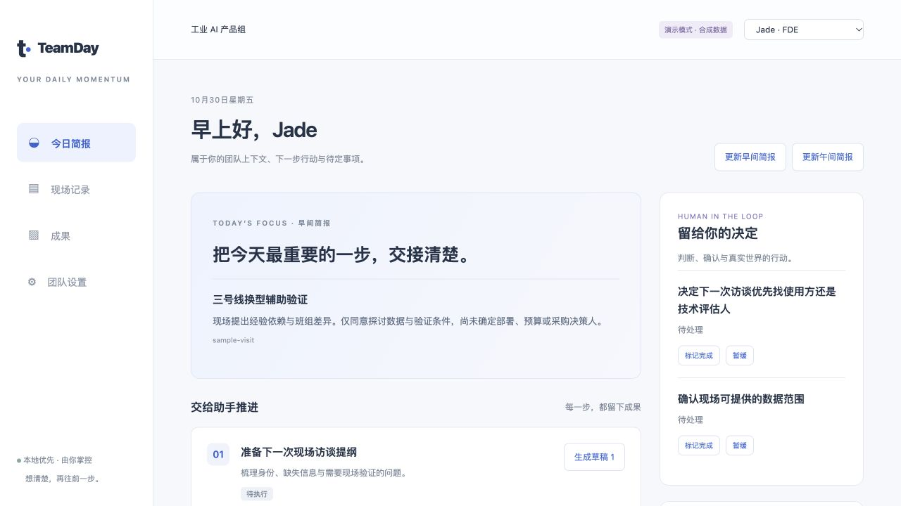

# TeamDay · 飞书里的团队行动助手

**每天一张简报，回复一个数字，把下一步变成工作初稿。**

现场信息回来了，团队的下一步也该跟上。TeamDay 把确认过的会议记录、个人待办和相关资料，整理成每位成员的每日简报；你选一个编号，它起草访谈提纲、交接简报或评审议程，交给你确认。

**简体中文** · [English](README.en.md) · [立即体验](#一分钟体验) · [接入飞书](docs/FEISHU.md) · [使用指南](docs/USAGE.md)



## 从现场，到下一步

- **说清一次，少解释几遍。** 粘贴已有会议转写，核对工厂、项目与参与者身份。原文保留，确认后才进入团队上下文。
- **每天知道先做什么。** 按成员角色准备早间 / 午间简报：项目重点、个人待办、匹配关注方向的资料候选。
- **回复编号，拿到草稿。** 在飞书私聊选 `1`、`2`，让助手起草下一份访谈提纲、交接简报、产品评估或会议议程。
- **重要判断，轻量确认。** 草稿有来源、结果可下载；待办能完成、暂缓；共享与私人记录由你选择。

使用示意（合成场景）：

```text
TeamDay → Jade
今天先确认现场的数据授权范围。

我可以帮你生成初稿：
1. 准备下一次现场访谈提纲
2. 生成跨部门交接简报

Jade → 1
TeamDay → 返回访谈提纲草稿，保留待确认事项与资料来源。
```

## 一分钟体验

需要已安装 **Python 3.9+，macOS / Linux**；Windows 使用 WSL。在项目目录运行：

```bash
python3 app.py --open
```

也可在 macOS 双击 `启动演示.command`。浏览器打开 `http://127.0.0.1:8765`，不需要账号或 API Key，无须前端构建。演示采用合成数据与本地模板，不调用模型、不向飞书发送。

先选一项「生成草稿」，再到「现场记录」完成一次校准和确认，回到首页更新简报。完整操作见 [中文指南](docs/USAGE.md) / [English guide](docs/USAGE.en.md)。当前界面与生成内容为中文。

## 接入你的飞书团队

macOS 双击 `启动真实连接.command`：首次打开 `.env` 供你填写，之后自动准备虚拟环境与官方 SDK。你需要一次性准备模型凭证、飞书企业自建机器人及成员 `open_id`，按 [接入指南](docs/FEISHU.md) 完成组织授权。

手动安装：

```bash
cp .env.example .env
# 在本地填写 .env；已有文件时不要覆盖。
python3 -m venv .venv
source .venv/bin/activate
python -m pip install -r requirements-feishu.txt
python3 app.py --live --feishu-listen --open
```

先验证一位成员能收到简报并回复编号，再开启定时投递。默认示例为工作日 **08:00 / 13:00**；时间与时区可调整，服务需要持续运行。演示和真实模式使用独立数据库。

## 为真实团队保留边界

v0.1.0 是早期预览版。可选 RSS / Atom 候选、飞书私聊、数字回复和成果回写多维表格。信息源按关注关键词匹配，候选未经独立事实核查。

输出为 **Markdown 草稿**。日历忙闲与会议邀请、录音硬件直连、PPT/PDF 导出和飞书知识库自动同步尚未提供。真实模型和飞书权限需要在安装者的租户完成验证。

网页是绑定本机的管理员工作台，普通成员通过飞书私聊使用；本地成员切换不提供登录权限隔离。发布源码时排除 `.env`、`data/`、`config.json`、`config.demo.json` 和 `.venv/`。

## 为什么做 TeamDay

这个项目源于 Jade 的一线业务与团队运营工作流设想：现场细节不该在回程中丢失，会议纪要也应该帮助团队推进下一步。工业 AI 是起点；团队目标、角色、关注方向与信息源均可配置。

先把一条完整路径做好：**现场记录 → 人工确认 → 每日简报 → 编号起草 → 成果留存。**

## 开发与贡献

```bash
python3 -m unittest discover -s tests -v
python3 scripts/check_release.py
```

[架构](docs/ARCHITECTURE.md) · [验收记录](docs/ACCEPTANCE.md) · [发布说明](docs/RELEASE.md) · [贡献指南](CONTRIBUTING.md) · [安全说明](SECURITY.md) · [版本记录](CHANGELOG.md) · [MIT](LICENSE)
